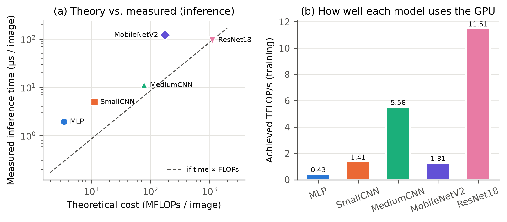

# Beyond FLOPs: Time–Space–Energy–Performance Analysis of Deep Image Classifiers on CIFAR-10

Code, raw measurements and paper for an experimental study of how the **theoretical cost** of
deep learning models (parameters, FLOPs, asymptotic complexity) relates to their **measured cost**
(training/inference time, RAM/VRAM, GPU energy) and their **accuracy**.

> 📄 **Paper (PDF):** [Beyond FLOPs: An Experimental Time–Space–Energy–Performance Analysis of Deep Image Classifiers on CIFAR-10](paper/main.pdf)
> — 6 pages, IEEE conference format · LaTeX source in [`paper/`](paper/)

Course project for *CSE303 Algorithm Analysis* · License: [MIT](LICENSE)

## Key findings

Five models trained on CIFAR-10 with one shared recipe, 4 training-set sizes (10/25/50/100%) × 5 seeds = **100 runs**,
on a single RTX 4060 Laptop GPU.

| Model | Params | MFLOPs/img | Accuracy (%) | Train time (s) | Train GPU energy (kJ) | Peak train VRAM (MB) |
|---|---:|---:|---:|---:|---:|---:|
| MLP | 1.71 M | 3.4 | 57.18 ± 0.32 | 35.4 | 1.22 | 58 |
| SmallCNN | 0.02 M | 11.2 | 69.03 ± 0.33 | 35.8 | 2.16 | 63 |
| MediumCNN | 0.29 M | 77.3 | 89.43 ± 0.08 | 62.7 | 4.66 | 104 |
| MobileNetV2 | 2.24 M | 176.0 | 91.76 ± 0.15 | 606.2 | 53.75 | 1227 |
| ResNet-18 | 11.17 M | 1110.8 | **92.87 ± 0.35** | 434.4 | 36.56 | 476 |

*Full training set (50k images), mean ± std over 5 seeds.*

- **Within a model, theory holds:** training time and energy grow linearly with data size
  (fitted exponent k = 0.96–1.01, R² ≥ 0.99) and peak GPU memory stays constant, exactly as
  T(n) = Θ(n) and GPU space O(1) in n predict.
- **Across models, FLOPs mislead:** MobileNetV2 needs 6.3× fewer FLOPs than ResNet-18 but trains
  1.4× slower, uses 1.47× more energy and 2.6× more training VRAM. It sustains only 1.3 TFLOP/s vs.
  11.5 TFLOP/s for ResNet-18 (depthwise convolutions are memory-bound).
- **Training memory is driven by activations, not parameters.**
- **Diminishing returns:** MediumCNN reaches 89.4% with 7.8× less energy than ResNet-18 (92.9%) and
  forms most of the accuracy–energy Pareto front.

## Figures

**Scaling with data size.** Time and energy grow linearly with the training-set size n, GPU memory
stays constant, and accuracy shows diminishing returns (paper Fig. 1).


**Theory vs. measurement across models.** Inference time is far from proportional to FLOPs, because
the achieved throughput differs by a factor of 27 between models (paper Fig. 2).



**Accuracy–energy trade-off.** MediumCNN forms most of the Pareto front; only full-data ResNet-18
extends it (paper Fig. 3).


## Repository structure

```
src/                     all code
  data.py                CIFAR-10 loading (cached), normalisation, nested stratified subsets, fast batch loader
  augment.py             GPU data augmentation (random flip + crop)
  models.py              MLP, SmallCNN, MediumCNN, MobileNetV2, ResNet-18 (CIFAR variants), FLOP/parameter counting
  train.py               shared training recipe and training loop
  measure.py             time / RAM / VRAM / energy measurement (NVML counter, 10 Hz sampling, CodeCarbon)
  experiment.py          one experiment = warm-up, measured training, metrics, measured inference, latency
  run_all.py             runs all 100 experiments (resumable) -> results/experiments.csv
  analyze.py             statistics, tables and paper figures
  check_env.py, explore_data.py, train_first_mlp.py, mlp_tuning.py, pilot.py,
  model_summary.py, speed_check.py, energy_check.py, repeat_check.py
                         development, pilot and validation scripts
results/
  experiments.csv        raw data: one row per run (100 rows, 75 columns)
  run_log.txt            log of the main run
  system_info.json       hardware and software versions of the main run
  summary.csv, table_main.*, table_metrics.*, scaling_fit.csv, theory_vs_measured.csv, energy_methods.csv
                         outputs of analyze.py
  model_summary.csv      parameters and FLOPs per model (model_summary.py)
  pilot_history.csv      per-epoch history of the pilot study (pilot.py)
figures/                 analysis figures (fig1–fig6) and development plots; the paper uses
                         fig2_scaling (paper Fig. 1), fig3_theory_vs_measured (Fig. 2)
                         and fig1_accuracy_vs_energy (Fig. 3)
paper/                   LaTeX source (main.tex, refs.bib), figures and compiled PDF
```

## Setup

Requirements: Windows or Linux, an NVIDIA GPU with a recent driver, Python 3.12.

Windows (PowerShell):

```powershell
python -m venv .venv
.\.venv\Scripts\Activate.ps1
pip install -r requirements.txt
python src/check_env.py           # checks PyTorch, CUDA and the GPU
```

Linux:

```bash
python3 -m venv .venv
source .venv/bin/activate
pip install -r requirements.txt
python src/check_env.py
```

If PowerShell refuses to run `Activate.ps1`, run
`Set-ExecutionPolicy -Scope CurrentUser RemoteSigned` once, or use `.venv\Scripts\activate.bat` in `cmd`.

CIFAR-10 is downloaded automatically on first use (from the Hugging Face copy `uoft-cs/cifar10`,
falling back to the official torchvision source) and cached as `data/cifar10.npz`.

## Reproducing the results

```bash
python src/run_all.py --trial     # 1–2 minute smoke test (separate output files)
python src/run_all.py             # main experiment: 100 runs, ~4–6 h on an RTX 4060 Laptop
python src/analyze.py             # tables in results/, figures in figures/
```

`run_all.py` appends each finished run to `results/experiments.csv` and skips completed runs when
restarted, so it can be interrupted and resumed. It also prevents Windows from sleeping and checks
at start-up that the GPU is not power-capped.

Notes on the measurement protocol (details in the paper, Section IV):

- Every run starts with an unmeasured warm-up (cuDNN autotuning, kernel loading).
- `torch.cuda.synchronize()` is called before every timing read.
- GPU energy comes from the NVML hardware energy counter; 10 Hz power sampling and CodeCarbon
  are recorded for comparison. CPU energy on AMD CPUs is only *estimated* by CodeCarbon.
- Within each seed the run order is shuffled; the GPU cools below 60 °C and its idle power is
  recorded before every run.
- Absolute numbers depend on the hardware and on laptop power settings. The main run used the
  vendor's "Performance" mode, maximum fan speed and a cooling pad.

## Building the paper

```bash
cd paper
tectonic -X compile main.tex      # or upload the paper/ folder to Overleaf
```

After re-running `analyze.py`, copy `figures/fig1_*.png`, `fig2_*.png` and `fig3_*.png` into `paper/figures/`.

The paper follows the AISCI 2027 rules (IEEE conference format, at most 6 pages including references).
The course version shows the author names; for the conference's double-blind review set `\blindtrue`
near the top of `main.tex` (and remove the repository link, which would reveal the authors).

## Limitations

- **One platform.** All numbers come from a single laptop GPU (RTX 4060 Laptop). The ranking across
  architectures is specific to GPUs: on a mobile CPU, MobileNetV2's FLOP advantage may well pay off.
- **One shared recipe.** All models use the same 30-epoch recipe for a fair comparison. It is not
  optimal for every model, so the accuracies are below the best published values; the cost
  comparison should not change with better tuning.
- **No validation split.** The pilot that fixed the recipe looked at test accuracy. To limit
  selection bias the recipe is never tuned per model, and every metric is taken after the final
  epoch, not at the best one.
- **Energy scope.** GPU energy is measured by the hardware counter. CPU energy is only *estimated*
  by CodeCarbon (the AMD CPU exposes no RAPL interface), and the shortest runs (a few seconds, MLP and
  SmallCNN on 10% data) are affected by the counter's granularity.
- **Laptop power management.** Absolute times and energies depend on the vendor power mode, cooling
  and driver. We fixed these for the whole run and logged power, clock and temperature per run.
- **Small images, small models.** CIFAR-10 (32×32) and models up to 11 M parameters; larger datasets
  and transformer-based models are not covered.

## Authors

CSE303 Algorithm Analysis project group (3 members):

- [@akca0](https://github.com/akca0)
- *two further group members (names will be added)*

## License

The code is released under the [MIT License](LICENSE). CIFAR-10 is not included in this repository;
it is downloaded from its original source on first use.

## Environment of the main run

| | |
|---|---|
| GPU | NVIDIA GeForce RTX 4060 Laptop, 8 GB, driver 621.24 |
| CPU / RAM | AMD Ryzen 7 7840HS (8C/16T), 32 GB |
| OS | Windows 11 |
| Software | Python 3.12.10, PyTorch 2.11.0 + CUDA 12.8, scikit-learn 1.9.1, CodeCarbon 3.3.2 |
