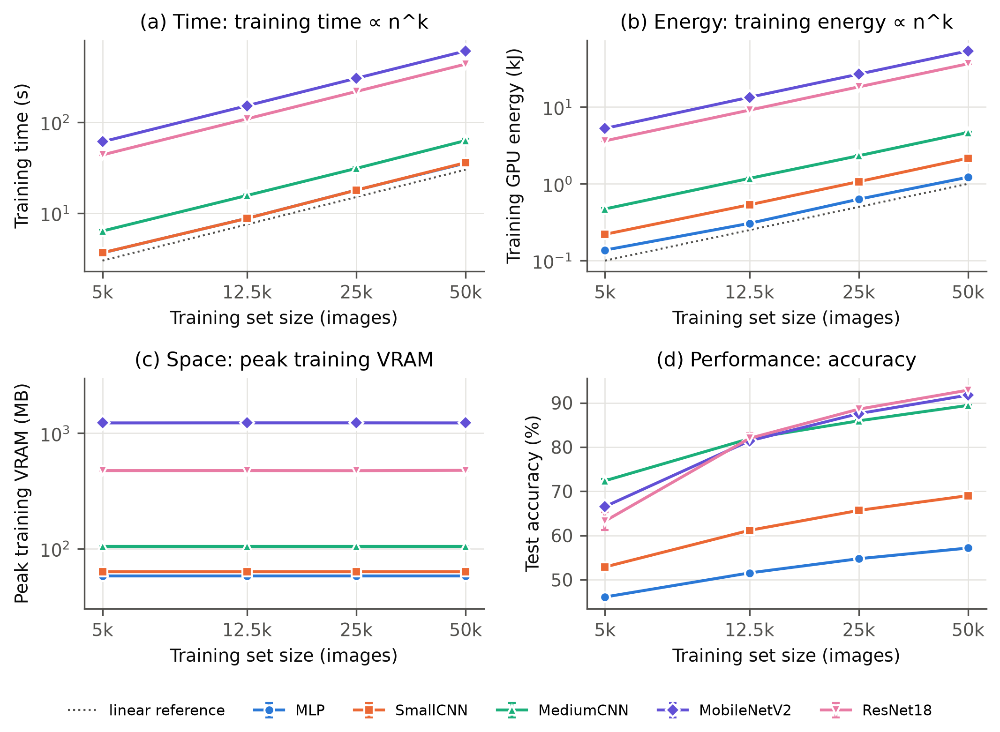
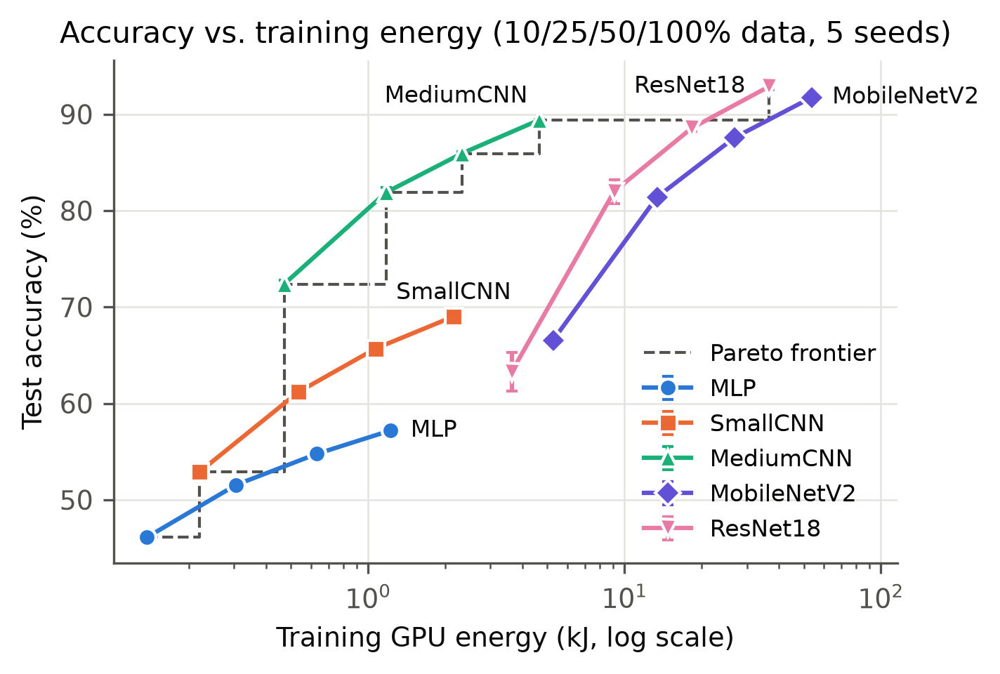

# Beyond FLOPs: Time–Space–Energy–Performance Analysis of Deep Image Classifiers on CIFAR-10

[](paper/main.pdf)
[](LICENSE)


Do parameter counts and FLOPs predict what a deep learning model really costs? We train five image
classifiers on CIFAR-10 under one shared recipe and measure, for every run, **performance**
(accuracy, precision, recall, F1), **time** (training, inference, latency), **space** (RAM, VRAM) and
**energy** (GPU hardware counter), across 4 training-set sizes × 5 seeds = **100 runs** on one laptop GPU.

> 📄 **Paper:** [Beyond FLOPs: An Experimental Time–Space–Energy–Performance Analysis of Deep Image Classifiers on CIFAR-10](paper/main.pdf)
> (6 pages, IEEE conference format, LaTeX source in [`paper/`](paper/)). Course project for *CSE303 Algorithm Analysis*.

## Figures

<p align="center">
  <br>
  <em>Scaling with data size: time and energy grow linearly, GPU memory stays constant, accuracy shows diminishing returns (paper Fig. 1).</em>
</p>

<table>
  <tr>
    <td width="55%"></td>
    <td width="45%"></td>
  </tr>
  <tr>
    <td><em>Theory vs. measurement: time is not proportional to FLOPs, because achieved throughput differs 27× between models (paper Fig. 2).</em></td>
    <td><em>Accuracy–energy trade-off: MediumCNN forms most of the Pareto front (paper Fig. 3).</em></td>
  </tr>
</table>

## Key findings

- **Within a model, theory holds.** Training time and energy grow linearly with data size
  (fitted exponent k = 0.96–1.01, R² ≥ 0.99) and peak GPU memory stays constant, exactly as
  T(n) = Θ(n) and GPU space O(1) in n predict.
- **Across models, FLOPs mislead.** MobileNetV2 needs 6.3× fewer FLOPs than ResNet-18 but trains
  1.4× slower, uses 1.47× more energy and 2.6× more training VRAM. It sustains only 1.3 TFLOP/s vs.
  11.5 TFLOP/s for ResNet-18 (depthwise convolutions are memory-bound).
- **Training memory is driven by activations, not parameters.** Parameters vs. peak training VRAM
  has a rank correlation of only ρ = 0.6.
- **Diminishing returns.** MediumCNN reaches 89.4% with 7.8× less energy than ResNet-18 (92.9%) and
  forms most of the accuracy–energy Pareto front.

## Research questions

1. **Data scaling:** Do training time, energy and memory grow with the training-set size *n* as the
   asymptotic analysis predicts (Θ(n) time, O(1) GPU memory in *n*)?
2. **Theory vs. measurement:** Do FLOPs and parameter counts predict measured time, energy and memory
   *across* architectures?
3. **Trade-off:** Which models give the best accuracy per unit of energy, and where do the returns diminish?
4. **Measurement:** How do hardware-counter, power-sampling and CodeCarbon energy figures compare?

## Experimental setup

| Model | Params | MFLOPs / image | Description |
|---|---:|---:|---|
| MLP | 1.71 M | 3.4 | 3072–512–256–10, batch norm, dropout 0.3 |
| SmallCNN | 0.02 M | 11.2 | 2 conv–BN–ReLU layers (32/64), max-pooling, global average pooling |
| MediumCNN | 0.29 M | 77.3 | VGG-style, 3 blocks of 2 conv layers (32/64/128) |
| MobileNetV2 | 2.24 M | 176.0 | inverted residuals, expansion 6, CIFAR stride variant |
| ResNet-18 | 11.17 M | 1110.8 | CIFAR variant (3×3 stem, no initial max-pool) |

- **Data:** CIFAR-10 (50k train / 10k test, 32×32). Nested, stratified training subsets of
  10 / 25 / 50 / 100% (5k / 12.5k / 25k / 50k images); metrics always on the full test set.
- **Design:** 5 models × 4 data sizes × 5 seeds = 100 runs. Seeds form the outer loop; within a seed
  the 20 runs are in a fixed random order. Before every run the GPU cools below 60 °C and its idle
  power is recorded.
- **Shared recipe (not tuned per model):** 30 epochs, batch 128, SGD with Nesterov momentum 0.9,
  learning rate 0.05, weight decay 5·10⁻⁴, cosine schedule stepped per batch, random flip + 4-pixel
  crop on the GPU, bfloat16 mixed precision.
- **Measurements:** unmeasured warm-up before each run (cuDNN autotuning); `cuda.synchronize()` before
  every timing read; peak VRAM (PyTorch) and peak RAM (10 Hz); GPU energy from the NVML hardware
  energy counter, cross-checked with 10 Hz power sampling and CodeCarbon.

## Results

**Full training set (50k images), mean ± std over 5 seeds.** Energy is GPU energy from the hardware
counter; throughput and inference energy at batch 512, latency (median) at batch 1.

| Model | Accuracy (%) | Train time (s) | Train energy (kJ) | Peak VRAM train / infer (MB) | Throughput (img/s) | Infer energy (mJ/img) | Latency (ms) |
|---|---:|---:|---:|---:|---:|---:|---:|
| MLP | 57.18 ± 0.32 | 35.4 ± 0.8 | 1.22 ± 0.04 | 58 / 43 | 515,762 | 0.08 | 0.42 |
| SmallCNN | 69.03 ± 0.33 | 35.8 ± 1.0 | 2.16 ± 0.04 | 63 / 95 | 203,230 | 0.39 | 0.51 |
| MediumCNN | 89.43 ± 0.08 | 62.7 ± 3.0 | 4.66 ± 0.12 | 104 / 154 | 90,687 | 0.96 | 1.15 |
| MobileNetV2 | 91.76 ± 0.15 | 606.2 ± 1.6 | 53.75 ± 0.09 | 1227 / 354 | 8,276 | 10.38 | 6.62 |
| ResNet-18 | **92.87 ± 0.35** | 434.4 ± 1.9 | 36.56 ± 0.12 | 476 / 495 | 10,532 | 8.04 | 3.30 |

<details>
<summary><b>Precision, recall and F1</b> (macro-averaged, full training set)</summary>

| Model | Accuracy (%) | Precision (%) | Recall (%) | F1 (%) |
|---|---:|---:|---:|---:|
| MLP | 57.18 ± 0.32 | 56.81 ± 0.30 | 57.18 ± 0.32 | 56.68 ± 0.34 |
| SmallCNN | 69.03 ± 0.33 | 68.93 ± 0.35 | 69.03 ± 0.33 | 68.86 ± 0.37 |
| MediumCNN | 89.43 ± 0.08 | 89.42 ± 0.10 | 89.43 ± 0.08 | 89.41 ± 0.08 |
| MobileNetV2 | 91.76 ± 0.15 | 91.75 ± 0.14 | 91.76 ± 0.15 | 91.74 ± 0.14 |
| ResNet-18 | 92.87 ± 0.35 | 92.88 ± 0.34 | 92.87 ± 0.35 | 92.87 ± 0.34 |

Macro recall equals accuracy because every CIFAR-10 test class has exactly 1000 images.
</details>

<details>
<summary><b>Accuracy vs. training-set size</b> (%, mean over 5 seeds)</summary>

| Model | 10% (5k) | 25% (12.5k) | 50% (25k) | 100% (50k) |
|---|---:|---:|---:|---:|
| MLP | 46.1 | 51.6 | 54.8 | 57.2 |
| SmallCNN | 52.9 | 61.2 | 65.7 | 69.0 |
| MediumCNN | **72.4** | 81.9 | 85.9 | 89.4 |
| MobileNetV2 | 66.6 | 81.4 | 87.6 | 91.8 |
| ResNet-18 | 63.3 ± 2.0 | **82.0** | **88.6** | **92.9** |

With little data the large models lose to MediumCNN and are less stable across seeds.
</details>

<details>
<summary><b>Scaling exponents</b> (least-squares fit of T, E ∝ n<sup>k</sup> in log–log space)</summary>

| Model | k (time) | R² (time) | k (energy) | R² (energy) |
|---|---:|---:|---:|---:|
| MLP | 0.990 | 0.999 | 0.957 | 0.995 |
| SmallCNN | 0.993 | 0.999 | 0.992 | 0.999 |
| MediumCNN | 0.993 | 0.999 | 0.995 | 0.999 |
| MobileNetV2 | 0.999 | 1.000 | 1.009 | 1.000 |
| ResNet-18 | 0.998 | 1.000 | 1.004 | 1.000 |
</details>

<details>
<summary><b>Theory vs. measurement</b> (ratios relative to ResNet-18)</summary>

| Model | FLOPs | Train time | Train energy | Infer time | Achieved train TFLOP/s |
|---|---:|---:|---:|---:|---:|
| MLP | 0.003 | 0.08 | 0.03 | 0.02 | 0.4 |
| SmallCNN | 0.010 | 0.08 | 0.06 | 0.05 | 1.4 |
| MediumCNN | 0.070 | 0.14 | 0.13 | 0.12 | 5.6 |
| MobileNetV2 | 0.158 | **1.40** | **1.47** | **1.27** | 1.3 |
| ResNet-18 | 1 | 1 | 1 | 1 | 11.5 |
</details>

**Energy-measurement methods.** Integrating 10 Hz power samples underestimates the counter by
6–17% (most for the shortest runs). CodeCarbon's GPU figure equals the counter (ratio 1.00) because
it reads the same NVML source, so it is not an independent check. CodeCarbon's total (GPU + CPU + RAM)
is 1.6–2.6× the GPU energy. All 100 runs used 908 kJ (0.25 kWh) of GPU training energy, about
213 g CO₂ according to CodeCarbon.

All raw numbers are in [`results/experiments.csv`](results/experiments.csv) (one row per run, 75 columns).

## Repository structure

```
src/                     all code
  data.py                CIFAR-10 loading (cached), normalisation, nested stratified subsets, fast batch loader
  augment.py             GPU data augmentation (random flip + crop)
  models.py              MLP, SmallCNN, MediumCNN, MobileNetV2, ResNet-18 (CIFAR variants), FLOP/parameter counting
  train.py               shared training recipe and training loop
  measure.py             time / RAM / VRAM / energy measurement (NVML counter, 10 Hz sampling, CodeCarbon)
  experiment.py          one experiment = warm-up, measured training, metrics, measured inference, latency
  run_all.py             runs all 100 experiments (resumable) -> results/experiments.csv
  analyze.py             statistics, tables and paper figures
  check_env.py, explore_data.py, train_first_mlp.py, mlp_tuning.py, pilot.py,
  model_summary.py, speed_check.py, energy_check.py, repeat_check.py
                         development, pilot and validation scripts
results/
  experiments.csv        raw data: one row per run (100 rows, 75 columns)
  run_log.txt            log of the main run
  system_info.json       hardware and software versions of the main run
  summary.csv, table_main.*, table_metrics.*, scaling_fit.csv, theory_vs_measured.csv, energy_methods.csv
                         outputs of analyze.py
  model_summary.csv      parameters and FLOPs per model (model_summary.py)
  pilot_history.csv      per-epoch history of the pilot study (pilot.py)
figures/                 analysis figures (fig1–fig6) and development plots; the paper uses
                         fig2_scaling (paper Fig. 1), fig3_theory_vs_measured (Fig. 2)
                         and fig1_accuracy_vs_energy (Fig. 3)
paper/                   LaTeX source (main.tex, refs.bib), figures and compiled PDF
```

## Installation

Requirements: Windows or Linux, an NVIDIA GPU with a recent driver, Python 3.12.

Windows (PowerShell):

```powershell
python -m venv .venv
.\.venv\Scripts\Activate.ps1
pip install -r requirements.txt
python src/check_env.py           # checks PyTorch, CUDA and the GPU
```

Linux:

```bash
python3 -m venv .venv
source .venv/bin/activate
pip install -r requirements.txt
python src/check_env.py
```

If PowerShell refuses to run `Activate.ps1`, run
`Set-ExecutionPolicy -Scope CurrentUser RemoteSigned` once, or use `.venv\Scripts\activate.bat` in `cmd`.

CIFAR-10 is not included in the repository. It is downloaded automatically on first use (from the
Hugging Face copy `uoft-cs/cifar10`, falling back to the official torchvision source) and cached as
`data/cifar10.npz`.

## Reproducing the results

```bash
python src/run_all.py --trial     # 1–2 minute smoke test (separate output files)
python src/run_all.py             # main experiment: 100 runs, ~4–6 h on an RTX 4060 Laptop
python src/analyze.py             # tables in results/, figures in figures/
```

`run_all.py` appends each finished run to `results/experiments.csv` and skips completed runs when
restarted, so it can be interrupted and resumed. It also prevents Windows from sleeping and checks
at start-up that the GPU is not power-capped. Absolute numbers depend on the hardware and on laptop
power settings; the main run used the vendor's "Performance" mode, maximum fan speed and a cooling pad.

To rebuild the paper:

```bash
cd paper
tectonic -X compile main.tex      # or upload the paper/ folder to Overleaf
```

After re-running `analyze.py`, copy `figures/fig1_*.png`, `fig2_*.png` and `fig3_*.png` into `paper/figures/`.

## Hardware & software

| | |
|---|---|
| Machine | HP Victus 16 laptop, vendor "Performance" mode, fan at maximum, cooling pad |
| GPU | NVIDIA GeForce RTX 4060 Laptop, 8 GB, power limit 113 W, driver 621.24 |
| CPU / RAM | AMD Ryzen 7 7840HS (8C/16T), 32 GB |
| OS | Windows 11 |
| Software | Python 3.12.10, PyTorch 2.11.0 + CUDA 12.8, scikit-learn 1.9.1, CodeCarbon 3.3.2 |
| Main run | 100/100 runs without error in 3 h 38 min; GPU clock 2505 MHz, max 73 °C |

## Limitations & future work

**Limitations**

- **One platform.** All numbers come from a single laptop GPU. The ranking across architectures is
  specific to GPUs: on a mobile CPU, MobileNetV2's FLOP advantage may well pay off.
- **One shared recipe.** All models use the same 30-epoch recipe for a fair comparison. It is not
  optimal for every model, so the accuracies are below the best published values; the cost
  comparison should not change with better tuning.
- **No validation split.** The pilot that fixed the recipe looked at test accuracy. To limit
  selection bias the recipe is never tuned per model, and every metric is taken after the final
  epoch, not at the best one.
- **Energy scope.** GPU energy is measured by the hardware counter. CPU energy is only *estimated*
  by CodeCarbon (the AMD CPU exposes no RAPL interface), and the shortest runs (a few seconds, MLP and
  SmallCNN on 10% data) are affected by the counter's granularity.
- **Laptop power management.** Absolute times and energies depend on the vendor power mode, cooling
  and driver. We fixed these for the whole run and logged power, clock and temperature per run.
- **Small images, small models.** CIFAR-10 (32×32) and models up to 11 M parameters.

**Future work**

- Repeat the protocol on CPUs and mobile hardware, where the ranking of the models may change.
- Measure CPU energy directly on RAPL-capable (Intel or Linux) systems.
- Tune the recipe per model and check whether the cost comparison stays the same.
- Extend the study to larger datasets (e.g. ImageNet subsets) and transformer-based vision models.

## Citation / paper

The full paper is [`paper/main.pdf`](paper/main.pdf). If you use this code or data, please cite it:

```bibtex
@misc{beyondflops2026,
  title  = {Beyond {FLOPs}: An Experimental Time--Space--Energy--Performance Analysis
            of Deep Image Classifiers on {CIFAR-10}},
  author = {{The cifar10-beyond-flops authors}},
  year   = {2026},
  note   = {CSE303 Algorithm Analysis course project},
  url    = {https://github.com/akca0/cifar10-beyond-flops}
}
```

**Authors.** CSE303 Algorithm Analysis project group (3 members): [@akca0](https://github.com/akca0)
and two further group members (names will be added).

**License.** The code is released under the [MIT License](LICENSE).
